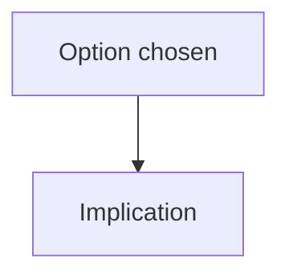

# ADR-XXXX — Title

| Field | Value |
|-------|-------|
| Status | proposed / confirmed / superseded |
| Date | YYYY-MM-DD |
| Deciders | |
| Tags | architecture / data / security / … |

## Context

What forces and constraints led here?

## Decision

What did we choose?

## Consequences

- Positive:
- Negative / tradeoffs:
- Follow-ups:

## Diagram (optional)

## Alternatives considered

| Option | Why not |
|--------|---------|
| | |

## Supersedes / superseded by

- Supersedes: —
- Superseded by: —

## Human approval

- [ ] **Confirm** (status → confirmed)
- [ ] **Reject / revise**
- [ ] **Supersede** with ADR-…

Approver: ________  Date: ________
