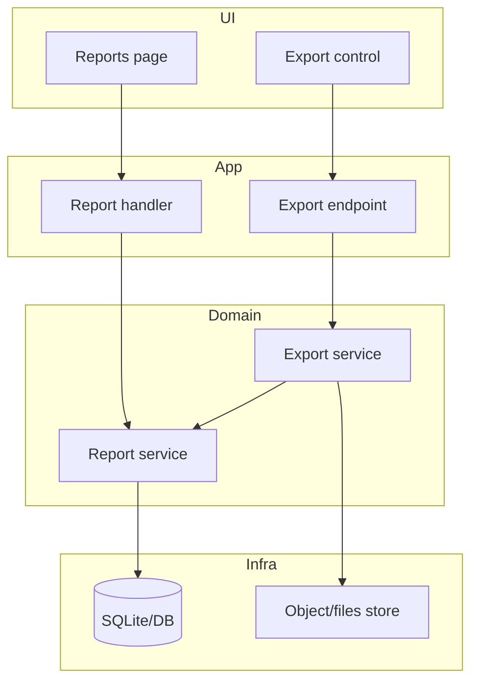

# Example — export feature — component to-be

## Delta (example)

- Changes: add Export control, endpoint, service, file store write
- Stays: existing report read path and DB ownership
- Risks: large-file timeouts; authz on export must match report ACLs
