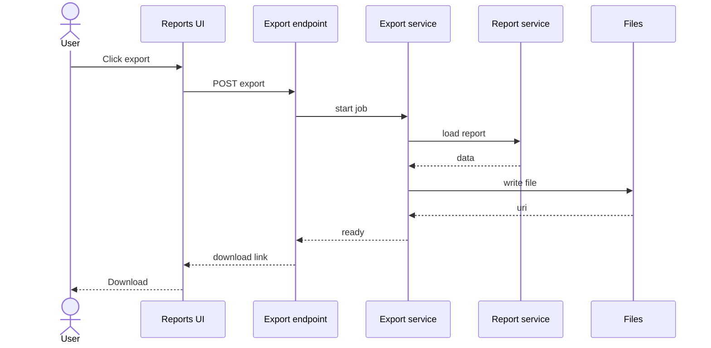

# Example — export feature — sequence to-be

## Delta (example)

- Changes: async-capable export job + download link
- Stays: report load semantics and authz source of truth
- Risks: link expiry; PII in exported files
