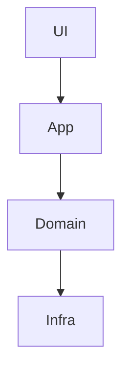
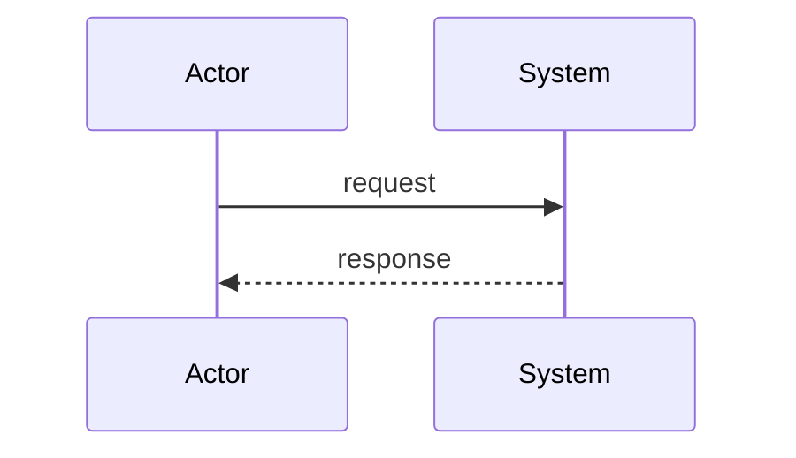

# Stage 0b — Architecture baseline (brownfield)

| Field | Value |
|-------|-------|
| Repo / project id | |
| Baseline version | v1 |
| Date | |

## As-is — component / package



## As-is — key sequence



## Decision list (ADR harvest)

| ADR id | Summary | Status | Source |
|--------|---------|--------|--------|
| ADR-0001 | | inferred / confirmed / superseded | code / README / PR |

## Boundaries (allowed dependency directions)

```text
UI → App → Domain → Infra
```

Store in context `boundaries`.

## Doc debt spotted

| Area | Gap | Severity |
|------|-----|----------|
| | | |

## Human approval

Baseline becomes constraints for all later work until amended.

- [ ] **Approve** architecture baseline
- [ ] **Approve with notes:** …
- [ ] **Reject (fix in this stage):** …

Approver: ________  Date: ________
