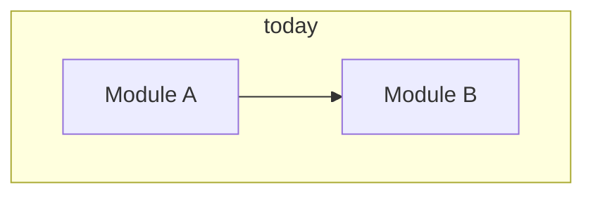
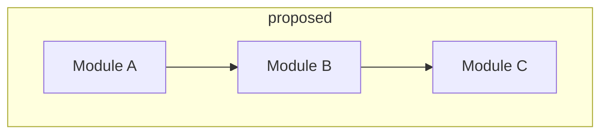
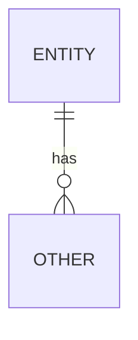

# Stage 3 — Design

| Field | Value |
|-------|-------|
| Feature id | |
| Date | |

## As-is

## To-be

## Delta caption (3–7 bullets)

- Changes:
- Stays:
- Risks:

## Contracts

| Interface / API / event | Shape / errors | Owner |
|-------------------------|----------------|-------|
| | | |

## Data shape (if any)

## ADR updates

- [ ] None — fits confirmed ADRs
- [ ] New ADR: …
- [ ] Amend ADR-… (requires explicit human approve)

## Human approval

- [ ] **Approve** design (pair + delta + contracts)
- [ ] **Approve with notes:** …
- [ ] **Reject (fix in this stage):** …

Approver: ________  Date: ________
