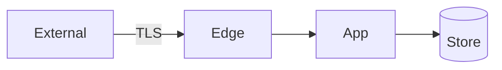

# Stage 4 — Threat & privacy review

| Field | Value |
|-------|-------|
| Feature id | |
| Date | |

## Trigger check

Does this change any of: auth, data stores, network/trust boundaries, PII?

- [ ] **Yes** — complete full section below
- [ ] **No** — fill short note only

### Short note (when No)

> No new trust boundary: …

## Abuse cases & threats

| Threat | Impact | Mitigation | Status |
|--------|--------|------------|--------|
| | | | open / mitigated |

## Trust boundary diagram (if changed)

## Secrets / PII

| Data | Classification | Handling |
|------|----------------|----------|
| | | |

## Human approval

- [ ] **Approve**
- [ ] **Approve with notes:** …
- [ ] **Reject (fix in this stage):** …

Approver: ________  Date: ________
