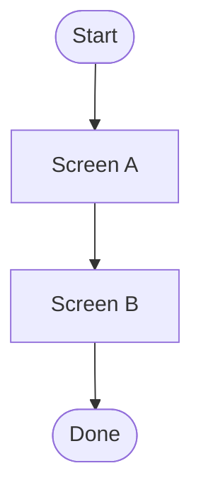

# Stage 5 — UI/UX

| Field | Value |
|-------|-------|
| Feature id | |
| Date | |
| Mode | sketch (with Design) / polish (after tests) |

## Flows

## Empty / error / loading states

| State | Behavior |
|-------|----------|
| Empty | |
| Error | |
| Loading | |

## Accessibility checklist

- [ ] Keyboard reachable
- [ ] Focus order sensible
- [ ] Labels / names for controls
- [ ] Contrast adequate for target WCAG level
- [ ] Errors announced / recoverable

## Human approval

- [ ] **Approve**
- [ ] **Approve with notes:** …
- [ ] **Reject (fix in this stage):** …

Approver: ________  Date: ________
