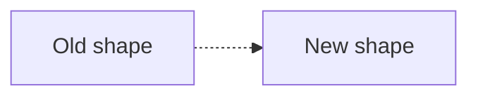

# Stage 9 — Refactor

| Field | Value |
|-------|-------|
| Feature id | |
| Date | |

## Intent

Clarity / performance / structure — **no intentional behavior change**.

## As-is → to-be (if structure changes)

Delta:

-

## Docs bar (required)

- [ ] Diagrams updated or confirmed unchanged
- [ ] Module/package overview updated if structure moved
- [ ] Public contracts / API docs refreshed
- [ ] ADR amended if boundary/pattern changed (human approved)
- [ ] `doc_debt` cleared or deferred by human

## Tests

- [ ] Suite green after refactor

## Human approval

- [ ] **Approve**
- [ ] **Approve with notes:** …
- [ ] **Reject (fix in this stage):** …

Approver: ________  Date: ________
